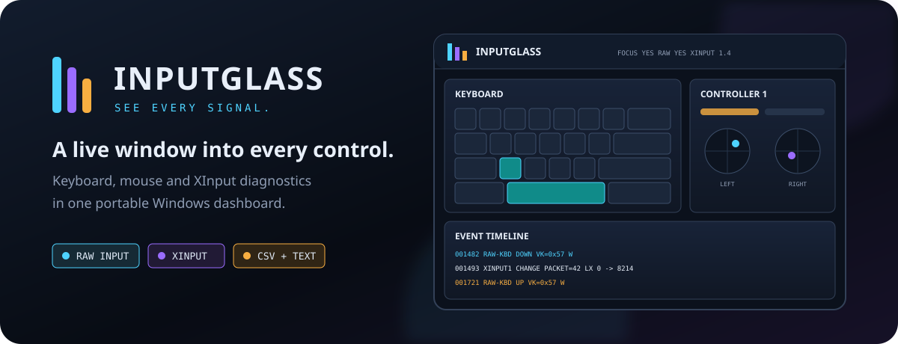

<p align="center">
  
</p>

<p align="center">
  <a href="https://github.com/arro000/inputglass/actions/workflows/build.yml"></a>
  <a href="https://github.com/arro000/inputglass/releases/latest"></a>
  <a href="LICENSE"></a>
  
  
</p>

**InputGlass** is a portable Windows diagnostics dashboard for keyboard, mouse, and XInput
controllers. It turns every control into visible, timestamped telemetry so you can inspect what
Windows actually receives from physical devices, virtual gamepads, remappers, remote sessions, and
compatibility layers.

No installer, administrator rights, network access, DirectX SDK, SDL, .NET, or background service is
required. Run one executable and start testing.

## What You Can See

- **Keyboard:** live state for a full ANSI keyboard, separate left/right modifiers, Numpad Enter,
  press/release/repeat counters, and hold duration.
- **Mouse:** five buttons, vertical and horizontal wheel input, client coordinates, raw relative or
  absolute movement, last delta, and accumulated delta.
- **Controllers:** four XInput slots with every digital button, both triggers, both sticks, packet
  numbers, connection state, and the number of fields changed in each observed sample.
- **Timeline:** a color-coded 512-event live view backed by complete CSV and readable text logs.
- **Fallback visibility:** Raw Input drives the dashboard while corresponding Win32 messages remain
  visible for comparison. If Raw Input registration fails, Win32 messages take over.

## Good For

- validating virtual gamepad mappings and multi-button chords;
- diagnosing stuck keys, missing releases, repeats, dead zones, and trigger ranges;
- comparing Raw Input with regular Win32 keyboard and mouse messages;
- testing remappers, streaming clients, virtual machines, Wine, or Winlator setups;
- attaching precise event traces to input-related bug reports.

## Download

Download `InputGlass-windows-x64.zip` from the
[latest release](https://github.com/arro000/inputglass/releases/latest), extract it, and run
`InputGlass.exe`.

Windows may show a SmartScreen warning because community builds are not code-signed. The executable
is produced directly by the public GitHub Actions workflow; every release includes a SHA-256
checksum.

## Usage

1. Launch `InputGlass.exe` and keep the window focused while testing keyboard or mouse input.
2. Connect up to four XInput-compatible controllers.
3. Exercise one control or combination at a time and watch the dashboard and event timeline.
4. Select **Clear** to reset per-control counters and the timeline without interrupting the current
   session log; a new `CLEAR` marker remains visible.
5. Select **Open session folder** to inspect or share the CSV and text traces.

The header should report `FOCUS YES`, `RAW YES`, a loaded XInput DLL, and `LOGGING ON`. XInput is
resolved from the Windows system directory and sampled every 16 ms. The displayed **fields changed**
value describes differences from the previous observed sample; it is not a guarantee that the
device changed those fields atomically.

## Session Logs

InputGlass creates a unique pair of files for every run:

```text
%LOCALAPPDATA%\InputGlass\logs\InputGlass-session-YYYYMMDD-HHMMSS-PID.csv
%LOCALAPPDATA%\InputGlass\logs\InputGlass-session-YYYYMMDD-HHMMSS-PID.txt
```

If that directory is unavailable, InputGlass falls back to the executable directory. Records are
buffered and flushed at most every 250 ms, limiting measurement interference while keeping recent
events durable. A normal shutdown always performs a final flush.

CSV columns are:

```text
timestamp_ms,source,action,code,name,value
```

Input logs can reveal typed keys and control sequences. Review them before sharing. InputGlass has no
network code or telemetry and never uploads a session.

## Build From Source

### Cross-compile on Linux

Install CMake and the x86-64 MinGW-w64 toolchain. On Debian or Ubuntu:

```sh
sudo apt install cmake gcc-mingw-w64-x86-64 binutils-mingw-w64-x86-64
./build.sh
```

The executable is written to `build/bin/InputGlass.exe`. Compatible tools can be selected through
`CC` and `RC`:

```sh
CC=x86_64-w64-mingw32-gcc RC=x86_64-w64-mingw32-windres ./build.sh
```

### Build on Windows

From a Visual Studio developer shell:

```powershell
cmake -S . -B build
cmake --build build --config Release
```

The project treats compiler warnings as errors in both local and CI builds.

## Design Notes

InputGlass is deliberately small: one native C11 application, Win32/GDI rendering, Raw Input, and
dynamically loaded XInput. The release binary has no third-party runtime dependencies. XInput DLLs
are loaded only from the Windows system directory to avoid unsafe DLL search behavior.

The application targets Windows 7 and newer. Per-monitor DPI behavior is enabled where supported.
Wine and Winlator can work well, but their Raw Input and XInput behavior varies by version and host
configuration.

## Limitations

- The visual keyboard follows a common ANSI-US layout; uncommon, media, and some ISO keys may appear
  only in the event timeline.
- XInput polling is timer-driven and intended for diagnostics, not latency benchmarking.
- Runtime input behavior cannot be fully validated by the cross-compilation CI job; physical and
  virtual device checks still require a Windows-compatible environment.
- InputGlass currently ships an x86-64 build.

## Contributing

Issues and focused pull requests are welcome. Read [CONTRIBUTING.md](CONTRIBUTING.md) before making a
change. For security-sensitive reports, follow [SECURITY.md](SECURITY.md).

InputGlass is available under the [MIT License](LICENSE).
